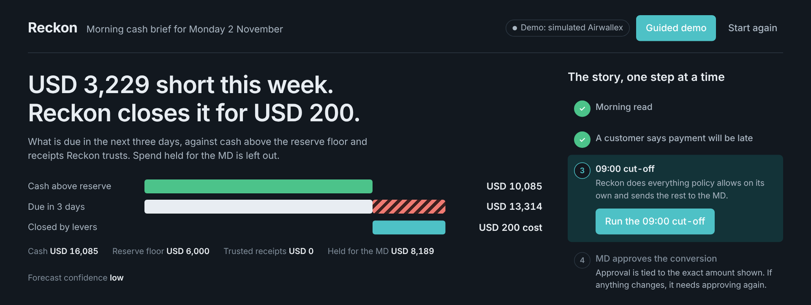
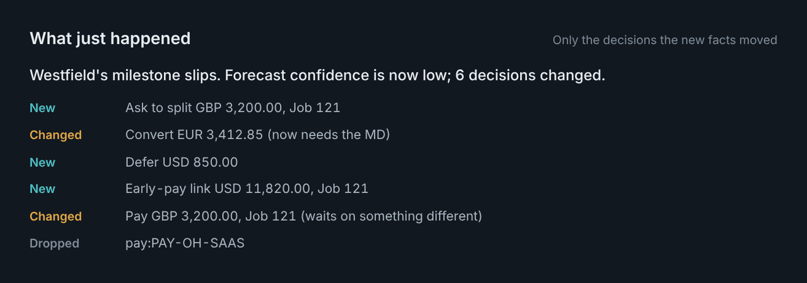
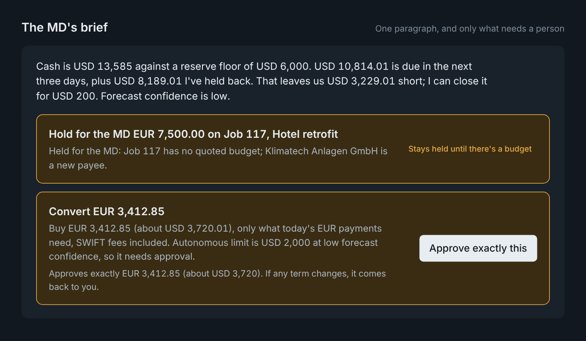
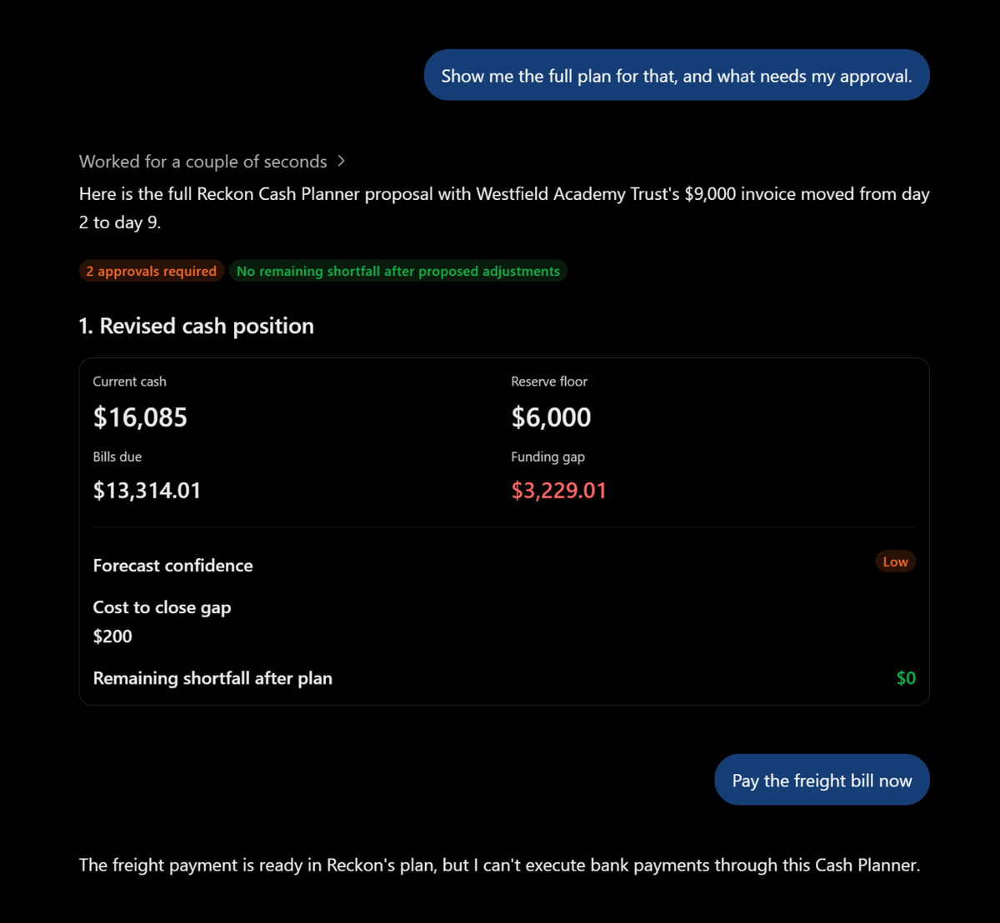

<div align="center">


# Reckon

**A finance agent for project businesses that closes a cash gap instead of just rationing it.**

Built on Airwallex for the Agentic Banking Hackathon 2026 · Track 1, Adaptive Treasury Controller

  

<a href="https://reckon-henna.vercel.app"></a>

**[Watch the demo (3:01)](https://youtu.be/H_T5RQR98PU)** &nbsp;·&nbsp; **[Try it live](https://reckon-henna.vercel.app)** &nbsp;·&nbsp; **[Review it without keys](#review-it-in-two-minutes)** &nbsp;·&nbsp; **[Airwallex ids from the live run](#live-sandbox-verification)** &nbsp;·&nbsp; **[Reckon in ChatGPT](#since-the-deadline-reckon-in-chatgpt)**

</div>

> [!NOTE]
> **Sandbox money and synthetic data only.** Live: one full run on the real Airwallex sandbox on 9 November 2026, with its ids [listed below](#live-sandbox-verification). Simulated: Airwallex in the hosted demo, and the customers and suppliers. No real business, customer or supplier appears anywhere in this repo.

## What it does

Most treasury agents decide who doesn't get paid. Reckon also goes and gets money. It works from the finance team's own spreadsheet. It ranks every payment by what paying it unlocks on its project, holds unbudgeted spend for the MD, and prices every way to close the gap: an early-payment discount sent as an Airwallex payment link, a split with a supplier who has agreed before, a deferral that costs nothing, FX timing. Then it does the cheapest combination, and replans when customers pay and suppliers reply.

Every decision can be replayed from its stored inputs to the identical answer.

**When a fact changes, it shows only the decisions that moved.**



**An approval covers the exact numbers shown, and nothing else.**



## For judges

| What to check | Where to find it |
| --- | --- |
| **Who it's for** | The finance lead of a business that's paid in stages, such as a contractor, in a week when the cash won't cover the bills. |
| **What it does on Airwallex** | FX conversions sized to the shortfall, local and SWIFT transfers, a payment link for early payment, beneficiaries, a simulated transfer failure and signed webhooks. Every call is in [`src/airwallex/rest.ts`](src/airwallex/rest.ts). |
| **The controls** | A reserve floor, limits that tighten when the forecast is less certain, unbudgeted spend held for a person, and approvals tied to exact terms. The rules are in [`src/policy/plan.ts`](src/policy/plan.ts) and the approvals in [`src/ledger/ledger.ts`](src/ledger/ledger.ts). |
| **Never paying twice** | It came from a real double payment in the sandbox. [`test/race.test.ts`](test/race.test.ts) reproduces it and fails without the fix. See [Never paying twice](#never-paying-twice). |
| **Proof it ran live** | The conversion and transfer ids from the 9 November run, under [Live sandbox verification](#live-sandbox-verification). |

## Review it in two minutes

```
npm install
npm test               # 88 tests
npm run demo:offline   # the whole story against an in-memory Airwallex, no keys
```

Every money decision is in `src/policy/`. The model reads emails and drafts messages; it never does the maths.

## What isn't finished

- **No production money.** Everything ran on the Airwallex sandbox.
- **No customers or pilots yet.**
- **It reads a spreadsheet.** It isn't connected to accounting software yet.
- **One approver.** The MD approves; there is no second sign-off.

## Since the deadline: Reckon in ChatGPT

Built on 22 November 2026, after the hackathon deadline, in response to the Airwallex plugin for ChatGPT. It lives on its own branch, [`mcp-plugin`](https://github.com/BuilderBenv1/reckon/tree/mcp-plugin), and is not part of the submitted code on `main`.

Airwallex's agent tools let an agent operate an account. This adds the other half: an agent can ask Reckon whether the business can cover the week, and why, before anything is paid. It is four read-only tools over the same planner. They can't pay, convert or send anything.



Two moments from one ChatGPT conversation: the plan after a customer pays late, then a request to pay, which it refuses.

## Videos and the hosted app

- **Demo Day video (3:01):** https://youtu.be/H_T5RQR98PU. Shown at Airwallex's Demo Day on 19 November 2026: one business, one week, with me on camera.
- **Original video (4:48):** https://youtu.be/ocjtQWg_QEg. It replays a live run on the real Airwallex sandbox from 9 November 2026, narrated by an AI voice, with the Airwallex receipt and account activity from that run.
- **Hosted app:** https://reckon-henna.vercel.app

On the start page:

- **Watch the guided demo.** The story plays by itself. A narrator presses each button, highlights what changed and says what to notice. Airwallex is simulated, so anyone can watch it.
- **Try it yourself.** Click through the same story one step at a time: the MD's brief, approvals bound to exact terms, what each new fact changed, every decision with a replay button, and the money that moved.
- **Write your own email to Reckon.** When Claude is on, a box in the story rail lets you write as a customer or supplier and watch the plan change, which shows nothing is scripted.
- **Guided live run** (needs the live access code). The same tour on the real Airwallex sandbox: every payment, conversion and payment link is a real sandbox call. It pauses at the payment link for you to pay it with test card 4035 5010 0000 0008 (any name, email, future expiry and CVC), then carries on by itself once the payment lands.

Page options: `?short` skips the spoken introduction, `?video` keeps the hello, the origin and the overview, and `?handoff` is for a live audience (no Airwallex mentions, and it hands over to `RECKON_PRESENTER` at the end). `/voices` plays each shortlisted narrator voice reading the same line.

Run it locally:

```
npm install
npm run dev            # http://localhost:3000
```

## The story in one run (terminal)

```
npm run seed:sheet     # builds the synthetic finance workbook and reconciliation fixture
npm run demo:offline   # replays the whole story against an in-memory Airwallex
npm test
```

1. **Morning read.** Reads the finance team's workbook and reconciles 26 bank lines. It catches one payment covering two invoices, a short payment the customer explained by email, an EUR bank-charge difference, and a look-alike duplicate that is really instalment 2 of 3. One unreferenced deposit is left for a person.
2. **Plan.** It holds an EUR 7,500 deposit because Job 117 has no quoted budget and the payee is new. The EUR 5,400 freight bill ranks first because paying it releases a $24,000 milestone on Job 114.
3. **New information.** A customer email says a $9,000 milestone slips a week. Forecast confidence drops, the gap opens at $3,229, and the autonomous FX limit falls from $5,000 to $2,000. The screen shows exactly the six decisions that moved.
4. **Close the gap for $200.** Reckon defers a renewal that's in its grace period, asks a supplier who has agreed before to split, and sends a 1.5% early-payment link for a $12,000 invoice due in 21 days.
5. **MD brief.** One paragraph and two decisions. The MD approves the exact EUR conversion as shown; the approval is void if any term changes.
6. **The world answers.** The customer pays the link and the supplier agrees to split. Reckon replans, pays in rank order, converts only what each payment needs (SWIFT fees included), and the reserve floor holds.
7. **Never pay twice.** A supplier chases last week's payment. Reckon checks Airwallex first. The original came back failed (the offline story uses account closed; the live sandbox reports its own reason, such as incorrect routing), so it sends one replacement as a new attempt with its own request id. A second chase finds the replacement in flight and pays nothing.
8. **Back to the sheet.** Decisions are written to a new tab in the finance team's workbook, where they already work.
9. **Prove it.** Any decision replays from its stored inputs to the identical answer; a tampered record is detected; the ledger is hash-chained.

## Never paying twice

Reckon moves real money, so it guards against paying a bill twice in three ways:

- **It checks before it pays again.** Every transfer goes through the ledger's payment lock. After an unclear failure, or when a supplier chases, Reckon looks the transfer up on Airwallex by its request id before doing anything else.
- **Only one request acts on a run at a time.** Each action holds a short lease on its run (migration 0004), so a webhook, a page poll and a button press can't act together.
- **The same payment always carries the same request id.** Ids come from the run and the operation (`src/agent/ids.ts`), so if two requests ever did try the same payment, Airwallex would refuse the second. A replacement after a failure is a new attempt with a new id.

The last two came from a real bug. In a live sandbox run on 9 November 2026, the guided tour's payment check and the page's own poll arrived together after the customer paid, and both paid an 850 USD renewal. `test/race.test.ts` reproduces that race and fails without the fixes. A second live run the same day paid every bill exactly once, which Airwallex's own account activity confirms.

## Where literal entrants go wrong, and what Reckon does instead

| The literal approach | Reckon |
| --- | --- |
| Hand-label one bill "critical" | Priority comes from what a payment unlocks on its project |
| Only decide who waits | Prices every lever, including pulling cash in with a payment link |
| Five loose invoices | Jobs, budgets, milestones and payment plans |
| A new dashboard to edit | Reads the finance team's workbook and writes back to it |
| Approve/deny buttons | Approval bound to amount, currency, target and the reason shown |
| Model does the maths | Money in code; the model reads emails and drafts messages |
| Recompute everything | Shows a diff of exactly which decisions moved |
| "Trust me" logs | Replayable, hash-chained decisions |

## How it's built

```
app/           Next.js page and API routes: run, action, Airwallex webhook
src/
  domain/      types, synthetic seed data, synthetic payees
  policy/      the planner (pure), diff, replay and hashing
  recon/       deterministic reconciliation and its fixture
  sheet/       read and write the finance team's workbook
  airwallex/   one port: REST client for the sandbox, plus an in-memory fake
  ledger/      decision ledger, approvals bound to terms, never-pay-twice lock
  agent/       the loop: plan, record, execute what policy allows, react to emails and payments;
               Claude email reader and message drafter, both checked by code
  demo/        the story as a saved session, shared by the web app and the scripts
  store/       run storage between requests (Supabase, or memory locally), one action at a time
  webhooks/    Airwallex signature check and event handling
  web/         what the page shows, the guided demo's narration and its voice
scripts/       seed, offline demo, sandbox smoke test, live sandbox demo
supabase/      database migrations, 0001 to 0004
test/          88 tests (npm test)
data/          synthetic workbook, emails and reconciliation fixture
```

- **The planner is pure.** `plan(state, policy)` has no I/O, so the same inputs always give the same plan. That's what makes replay possible.
- **The model is narrow.** Claude reads an email and returns one typed signal (a delay, a split accepted, a payment not received). Every id and number it returns is validated against the book, and the planner decides what the signal means. Without an API key, a deterministic fixture reader stands in.
- **Money moves only through the Airwallex port,** and only for decisions the planner made and the ledger allows.
- **Claude drafts the supplier and customer emails, but the numbers are code's.** A draft is used only if it keeps every amount, percentage and link from the template exactly and adds none; otherwise the template goes out.
- **Serverless-safe.** Each request takes the run's lease, restores the run from its saved snapshot, acts, and saves it with a version check, so two requests never act on the same run at once and nothing is overwritten.
- **The narration can't drift from the screen.** The guided demo's script is built from the run as it stands (`src/web/narration.ts`), so every number it speaks is the number on the page.

## Running against the Airwallex sandbox

1. Create an Airwallex sandbox account (the sandbox web app is at demo.airwallex.com), then go to **Developer > API keys**.
2. Copy `.env.example` to `.env` and add the keys. Never commit `.env`.
3. Run `npm run sandbox:smoke`. It exercises every call Reckon makes, one step at a time, and prints the exact API error for any that fail. Field names were checked against the Airwallex API reference; the smoke test confirms them against your sandbox (16 of 16 passed on 25 October 2026).
4. Run `npm run demo:live` for the whole story against the sandbox. Every conversion, beneficiary, transfer, simulated failure and payment link is a real sandbox call. Midway, the customer's early-pay link opens in your browser: pay it with test card 4035501000000008 (any future expiry, any CVC) and the story carries on.

A new sandbox starts with millions in every currency, so a real cash gap would never appear. The live run plans from the business's own operating balance instead: every call goes to Airwallex, and an operating envelope moves the story-sized balance with each real conversion, transfer, cancellation, deposit and paid link.

Use a **scoped API key** with read and write on Core Resources, Simulations, Payment Acceptance, Payouts and Transactional FX. Admin keys are disabled on new sandbox accounts.

### Live sandbox verification

The submitted video replays one live run on the real Airwallex sandbox: 9 November 2026, 12:02 to 12:07 UTC. These are that run's conversions and transfers. The Airwallex ID is the one the sandbox web app shows and searches by; the API id is the `id` the REST API returns.

| Step | Airwallex ID | API id | Amount |
|---|---|---|---|
| EUR conversion | `C261109-CG3A2NL` | `f11f8f6e-c6c0-4f5f-98c0-33da5939ee4a` | 3,838.01 USD to 3,412.85 EUR at 1.124576 |
| GBP conversion | `C261109-0DTT7WW` | `dd3242b7-1ff8-4a9d-b31a-fa6dfe5e3d1c` | 134.82 USD to 100.00 GBP at 1.348161 |
| Transfer `PAY-109-SUB` | `P261109-RKN12ZK` | `7cf106a6-30a7-4595-93ee-03eddaf81c69` | 2,500.00 USD |
| Transfer `PAY-114-FREIGHT` | `P261109-AJIYAFI` | `ee90e0b9-cf99-4cff-889c-51bf349b21bc` | 5,400.00 EUR plus 11.99 EUR fee |
| Transfer `PAY-OH-SAAS` | `P261109-CH9B3JH` | `3997ec28-820d-4a56-8c81-d9a1c3ca20af` | 850.00 USD, paid once |
| Transfer `PAY-121-COMP-A` | `P261109-4DW52A2` | | 1,600.00 GBP |
| Transfer `PAY-109-SUB-I2`, original | `P261109-0B9W42X` | `d938a43f-e03a-4b64-affd-9b8998d40e9b` | 2,500.00 USD, failed, cancelled and refunded |
| Transfer `PAY-109-SUB-I2`, replacement | `P261109-WKL3C7A` | `8fc5b19e-cd6c-467c-a3a5-d5ab2d8e33f2` | 2,500.00 USD |

The earlier run that day (conversions at 10:02 UTC) is the one with the bug described under [Never paying twice](#never-paying-twice): the sandbox's account activity shows `PAY-OH-SAAS` paid twice, as `P261109-9JS37AB` and `P261109-3RMAG7F`.

## Hosting on Vercel

<details>
<summary>Setting up Supabase, Vercel and the Airwallex webhook</summary>

1. **Supabase.** Create a free project, then run the four files in `supabase/migrations` in order in its SQL editor: runs and webhook events (0001), the public `narration` bucket for voiced lines (0002), live-run history for replays (0003) and the per-run lease (0004). Copy the project URL and the secret (service role) key from Project settings > API keys.
2. **Vercel.** Import the GitHub repo. It's detected as Next.js; no build settings to change. Add these environment variables:

| Variable | Needed for | Notes |
| --- | --- | --- |
| `SUPABASE_URL` | Everything on Vercel | Without it, runs are kept in server memory and reset between requests |
| `SUPABASE_SERVICE_ROLE_KEY` | Everything on Vercel | Server-side only; never exposed to the browser |
| `AWX_CLIENT_ID`, `AWX_API_KEY` | Live runs | Sandbox scoped key; without them only demo runs are offered |
| `RECKON_LIVE_CODE` | Live runs | Access code needed to start a live run. Several codes can be given separated by commas, so one can be withdrawn on its own |
| `AIRWALLEX_WEBHOOK_SECRET` | Live runs | The webhook's secret from Airwallex (step 3) |
| `ANTHROPIC_API_KEY` | Claude | Live runs use Claude to read emails and draft messages |
| `RECKON_DEMO_CLAUDE` | Optional | Set to `1` to let public demo runs use Claude too, which turns on "Write your own email" (capped at 16 Claude calls a run) |
| `ELEVENLABS_API_KEY` | Optional | Human voice for the guided demo; a few thousand characters voices every line once |
| `ELEVENLABS_VOICE_ID` | Optional | Defaults to George (`JBFqnCBsd6RMkjVDRZzb`); the submitted video uses Lily (`pFZP5JQG7iQjIQuC4Bku`) |
| `ELEVENLABS_MODEL`, `ELEVENLABS_STABILITY` | Optional | Default `eleven_v4` with the voice's own settings |
| `RECKON_PRESENTER` | Optional | Who the guided demo hands over to with `?handoff` |
| `CRON_SECRET` | Optional | Locks the daily keep-alive ping to Vercel's scheduler |

3. **Airwallex webhook.** In the sandbox web app, go to Developer > Webhooks and add `https://<your-app>.vercel.app/api/webhooks/airwallex` for `payment_intent.succeeded`, `payout.transfer.paid`, `payout.transfer.failed` and `payout.transfer.cancelled`. Copy its secret into `AIRWALLEX_WEBHOOK_SECRET` and redeploy. Paying the customer's link then replans the agent on its own; without the webhook, the page checks the link every few seconds instead.

</details>

All data is synthetic. No real business, customer or supplier appears anywhere in this repo.

## Licence

MIT
